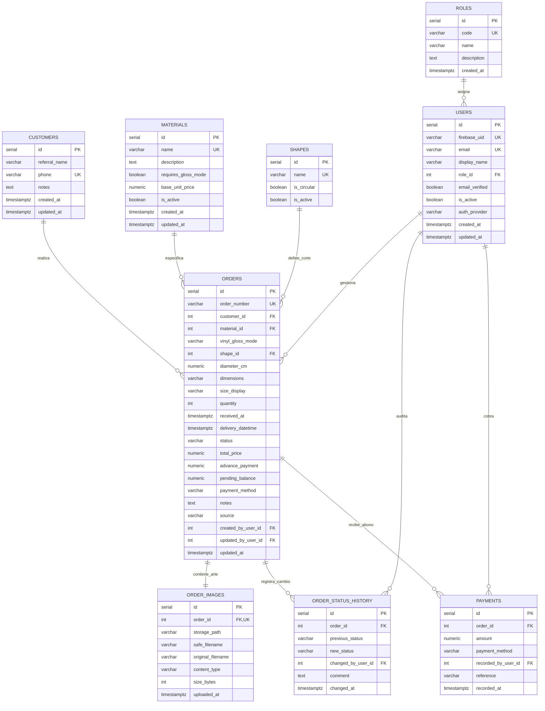

# Diseño de Base de Datos Relacional — SIETE Sticker Studio

Este documento presenta el **Modelo Conceptual**, el **Modelo Lógico (3FN)**, la **Justificación de Decisiones de Modelado** y la **Matriz de Restricciones de Integridad** implementados en **PostgreSQL** para el sistema web integral de la imprenta de stickers.

---

## 1. Modelo Conceptual (Entidad-Relación)

### Entidades Principales y Cardinalidades
1. **ROL (`roles`)** — *(1 : N)* → **USUARIO (`users`)**: Cada usuario interno o cliente registrado posee un único rol (`admin`, `operador`, `cliente`), y un rol agrupa a muchos usuarios.
2. **CLIENTE (`customers`)** — *(1 : N)* → **PEDIDO (`orders`)**: Un cliente (identificado por su teléfono/WhatsApp normalizado y nombre de referido) puede realizar múltiples pedidos a lo largo del tiempo.
3. **MATERIAL (`materials`)** — *(1 : N)* → **PEDIDO (`orders`)**: Catálogo administrable de sustratos (`Vinilo Brillo`, `Vinilo Mate`, `Transparente`, `DTF UV`, `Hojas Adhesivas`) con precio base y bandera condicional `requires_gloss_mode`.
4. **FORMA (`shapes`)** — *(1 : N)* → **PEDIDO (`orders`)**: Catálogo de formas de corte (`Circular`, `Rectangular`, `Cuadrado`, `En su forma`) con bandera `is_circular` que gobierna la regla condicional de tamaño.
5. **PEDIDO (`orders`)** — *(1 : 1)* → **IMAGEN_PEDIDO (`order_images`)**: Cada pedido almacena los metadatos del arte validado y renombrado con UUID (ruta segura, tipo MIME verificado y tamaño en bytes).
6. **PEDIDO (`orders`)** — *(1 : N)* → **HISTORIAL_ESTADO (`order_status_history`)**: Bitácora auditable de cada transición de estado de producción (`Pendiente` → `En Diseño` → `En Impresión` → `Troquelado` → `Listo` → `Entregado` / `Cancelado`).
7. **PEDIDO (`orders`)** — *(1 : N)* → **PAGO (`payments`)**: Registro histórico de abonos/adelantos recibidos con método de pago y operador responsable.
8. **USUARIO (`users`)** — *(1 : N)* → **PEDIDO / HISTORIAL / PAGO**: Trazabilidad completa de qué operador registró, editó o cobró cada transacción.

### Diagrama Entidad-Relación (Conceptual → Lógico)

---

## 2. Modelo Lógico (Relacional Normalizado en 3FN)

| Tabla | Llave Primaria (PK) | Llaves Foráneas (FK) | Llaves Únicas (UK) |
|---|---|---|---|
| `roles` | `id` | — | `code` |
| `users` | `id` | `role_id → roles(id)` | `firebase_uid`, `email` |
| `customers` | `id` | — | `phone` |
| `materials` | `id` | — | `name` |
| `shapes` | `id` | — | `name` |
| `orders` | `id` | `customer_id → customers(id)`, `material_id → materials(id)`, `shape_id → shapes(id)`, `created_by_user_id → users(id)`, `updated_by_user_id → users(id)` | `order_number` |
| `order_images` | `id` | `order_id → orders(id)` | `order_id` (garantiza 1:1) |
| `order_status_history` | `id` | `order_id → orders(id)`, `changed_by_user_id → users(id)` | — |
| `payments` | `id` | `order_id → orders(id)`, `recorded_by_user_id → users(id)` | — |

---

## 3. Justificación de Decisiones de Modelado

1. **Normalización en Tercera Forma Normal (3FN):**
   - Los atributos de clientes (`referral_name`, `phone`) se separan en `customers` para evitar redundancia cuando un cliente recurrente realiza múltiples pedidos y permitir historial consolidado por número de WhatsApp.
   - `materials` y `shapes` se modelan como catálogos independientes (en lugar de cadenas repetidas), habilitando mantenimiento CRUD sin duplicidad, control de precios base y reglas dinámicas (`requires_gloss_mode`, `is_circular`).
   - `roles` separa el control de permisos (RBAC: `admin`, `operador`, `cliente`) de los datos del perfil en `users`.
2. **Separación de Identidad (Firebase Auth) vs. Persistencia Transaccional (PostgreSQL):**
   - **Firebase Authentication** gestiona contraseñas con hashing seguro, OAuth con Google, correos transaccionales de verificación y recuperación sin almacenar contraseñas en texto plano ni administrar un servidor SMTP vulnerable.
   - **PostgreSQL** almacena los datos de negocio con transacciones ACID, integridad referencial fuerte y consultas analíticas SQL para reportes de ventas y KPIs. El enlace seguro se realiza mediante `users.firebase_uid` (`UNIQUE NOT NULL`).
3. **Relación 1:1 en `order_images` preparada para Fase 2:**
   - Separar los metadatos binarios del arte en `order_images` mantiene liviana la tabla `orders` en consultas masivas y facilita agregar en Fase 2 columnas o tablas derivadas para imágenes mejoradas (OpenCV), contornos SVG/DXF de troquelado IA y hojas de pliego.
4. **Auditoría Operativa y Financiera (`order_status_history` y `payments`):**
   - Cada cambio de estado de producción queda registrado con marca de tiempo y usuario responsable, y cada incremento de adelanto se registra en `payments`, garantizando trazabilidad contable real.
5. **Políticas de Integridad Referencial (`ON DELETE`):**
   - `ON DELETE RESTRICT` en `orders → customers`, `orders → materials`, `orders → shapes` y `users → roles`: impide borrar catálogos o clientes con historial de pedidos (evita registros huérfanos).
   - `ON DELETE CASCADE` en `order_images`, `order_status_history` y `payments` respecto a `orders`: al eliminar un pedido desde el CRUD administrativo, se limpian atómicamente sus artefactos dependientes.
   - `ON DELETE SET NULL` en columnas de auditoría (`created_by_user_id`, `updated_by_user_id`, `changed_by_user_id`, `recorded_by_user_id`): si un operador es dado de baja, el historial de pedidos y ventas se conserva íntegro.

---

## 4. Matriz de Restricciones de Integridad en PostgreSQL

| Restricción | Tabla | Regla Aplicada en SGBD |
|---|---|---|
| `chk_roles_code` | `roles` | `code IN ('admin', 'operador', 'cliente')` |
| `chk_materials_price` | `materials` | `base_unit_price >= 0` |
| `chk_orders_gloss_mode` | `orders` | `vinyl_gloss_mode IS NULL OR vinyl_gloss_mode IN ('En rollo', 'Corte uno a uno')` |
| `chk_orders_size_xor` | `orders` | `(diameter_cm IS NOT NULL AND dimensions IS NULL) OR (diameter_cm IS NULL AND dimensions IS NOT NULL)` |
| `chk_orders_diameter_range` | `orders` | `diameter_cm IS NULL OR (diameter_cm >= 0.5 AND diameter_cm <= 500)` |
| `chk_orders_quantity` | `orders` | `quantity >= 1 AND quantity <= 1000000` |
| `chk_orders_delivery_exact_hour` | `orders` | `EXTRACT(MINUTE FROM delivery_datetime) = 0 AND EXTRACT(SECOND FROM delivery_datetime) = 0` |
| `chk_orders_status` | `orders` | `status IN ('Pendiente','En Diseño','En Impresión','Troquelado','Listo','Entregado','Cancelado')` |
| `chk_orders_money_non_negative` | `orders` | `total_price >= 0 AND advance_payment >= 0 AND pending_balance >= 0` |
| `chk_orders_advance_le_total` | `orders` | `total_price = 0 OR advance_payment <= total_price` |
| `chk_orders_pending_balance` | `orders` | `pending_balance = GREATEST(0, total_price - advance_payment)` |
| `chk_orders_payment_method` | `orders` | `payment_method IN ('Pendiente','Efectivo','Transferencia','QR','Tarjeta','Mixto')` |
| `chk_orders_source` | `orders` | `source IN ('public', 'admin')` |
| `chk_order_images_mime` | `order_images` | `content_type IN ('image/png','image/jpeg','image/webp','image/svg+xml')` |
| `chk_order_images_size` | `order_images` | `size_bytes > 0 AND size_bytes <= 10485760` (10 MB) |
| `chk_payments_amount` | `payments` | `amount > 0` |
| `trg_*_updated_at` | `users`, `customers`, `materials`, `orders` | Trigger PostgreSQL que actualiza `updated_at = NOW()` en cada `UPDATE` |

---

## 5. Scripts SQL del SGBD

- Esquema DDL completo para PostgreSQL: [`database/schema_postgresql.sql`](../database/schema_postgresql.sql)
- Datos iniciales (roles, materiales, formas): [`database/seed.sql`](../database/seed.sql)
